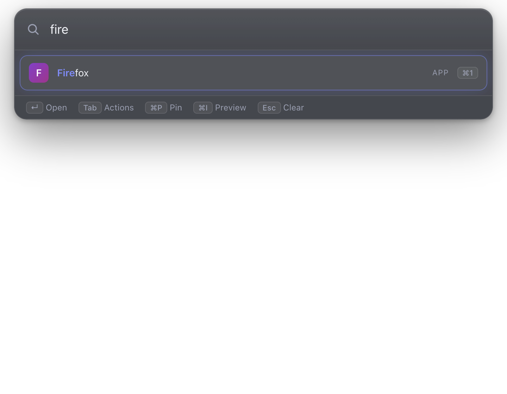
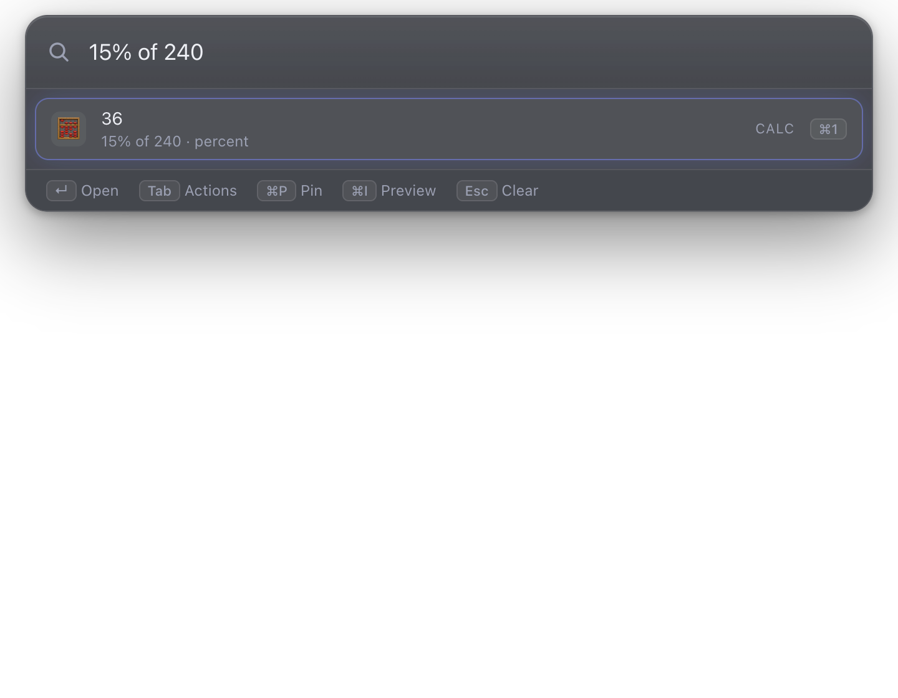
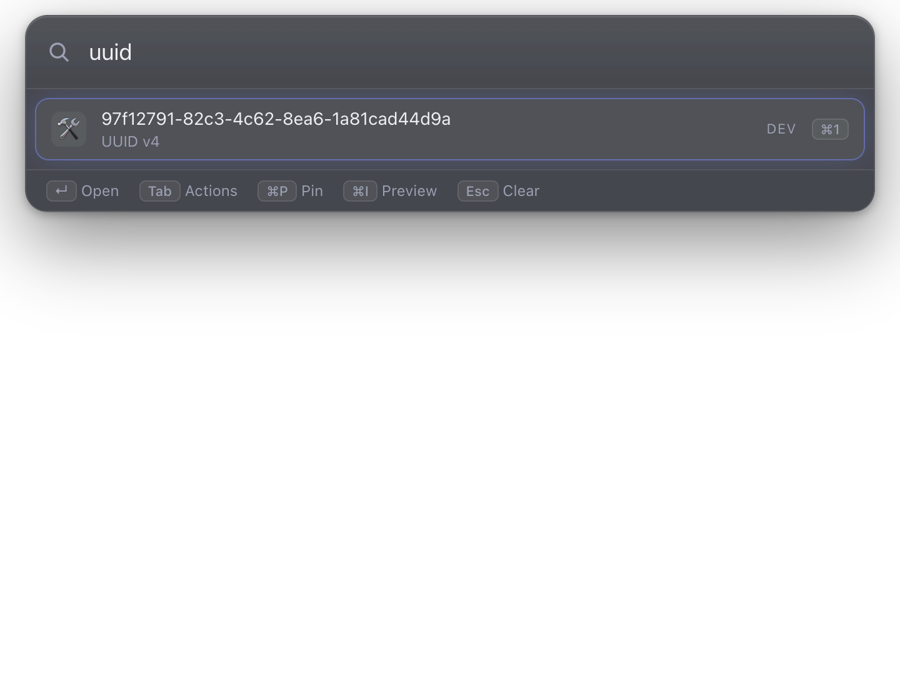

# Beacon

A local-first, keyboard-first command bar for Windows, macOS and Linux: press a shortcut, type, hit Enter. MIT licensed. **No telemetry, no accounts, no network calls.**



|                                                         |                                                           |
| ------------------------------------------------------- | --------------------------------------------------------- |
|  |  |

_Screenshots use demo data only._

## What it does

Apps · files (built-in index, Spotlight, Everything, plocate) · calculator, units, dates, timezones · clipboard history · snippets, notes, todos · timers · quicklinks · system commands · processes · bookmarks · SSH hosts · emoji, colors, dev utilities · a **hub** for Lorekeeper / Cipherkeep / Worldloom / Classpad · **Script Commands** with live output · workflows · sandboxed extensions · a CLI.

Everything is a provider with one contract; each can be switched off. See [docs/PROVIDERS.md](docs/PROVIDERS.md).

## Install

Download an installer from the [Releases](../../releases) page (Windows NSIS/portable, macOS universal dmg, Linux AppImage/deb/rpm). Builds are **unsigned**; first-launch steps are in [docs/PLATFORMS.md](docs/PLATFORMS.md). On Linux/Wayland, bind your desktop's shortcut to `beacon toggle`.

## Use

Default shortcut **Alt+Space** (Option+Space on macOS). Type to search; **↵** runs the top result, **Tab / Ctrl+K** shows actions, **Esc** goes back, **Ctrl/⌘+1…9** quick-picks, **Ctrl/⌘+P** pins, **Ctrl/⌘+Backspace** forgets, **Ctrl/⌘+I** previews. Prefixes focus a provider: `cb ` clipboard, `snip `, `note `, `todo `, `g `, `ssh `, `bm `, `f `, `hub`, `script new py hello`, `ext`.

## Develop

```bash
npm install
npm run dev
npm test && npm run lint && npm run typecheck && npm run e2e
```

[Developer guide](docs/CONTRIBUTING-DEV.md) · [Architecture](docs/ARCHITECTURE.md)

## Docs

[Providers](docs/PROVIDERS.md) · [Scripts](docs/SCRIPTS.md) · [Extensions & workflows](docs/EXTENSIONS.md) · [Integrations](docs/INTEGRATIONS.md) · [Platforms](docs/PLATFORMS.md) · [Privacy](docs/PRIVACY.md) · [Performance](docs/PERFORMANCE.md) · [Release notes](docs/RELEASE_NOTES.md)

## Privacy & safety

Local-only data (see [docs/PRIVACY.md](docs/PRIVACY.md)); clipboard results never appear in the default list; programs are only ever run with argument lists (no shell strings); scripts and extensions are trust-gated and default-deny.

## License

MIT
