# Architecture

Beacon is an Electron app (TypeScript everywhere) organised as an npm-workspaces monorepo. Everything is local: no telemetry, no accounts, no network calls.

```
                       ┌────────────────────────── main process ───────────────────────────┐
 global hotkey ───────▶│ window manager (hidden, warm launcher window)   tray   single-instance│
 beacon:// URLs        │ settings (JsonFile)   Fastify API 127.0.0.1 + token   clipboard poll │
 CLI (beacon …) ──────▶│ effects broker (clipboard, browser, notifications, hotkeys)          │
                       │ ExtensionManager ─────────────┐                                       │
                       └───────┬───────────────────────┼───────────────────────────────────────┘
                 MessagePort   │ (hot path bypasses main)│ utilityProcess per extension
        ┌───────────────┐      ▼                        ▼
        │ renderer      │◀────────────▶ ┌───────────────────────┐   ┌──────────────────────────┐
        │ React+zustand │   queries,    │ search worker         │   │ extension process        │
        │ virtual list  │   batches,    │ (utilityProcess)      │   │ QuickJS (WASM) sandbox,  │
        └───────────────┘   script      │ providers, ranking,   │   │ ctx.* → host-checked     │
                            events      │ frecency, indexes,    │   └──────────────────────────┘
                                        │ scripts, workflows    │   ┌──────────────────────────┐
                                        └──────────┬────────────┘   │ crawl child process      │
                                                   │ spawn(file,argv)│ (exits after indexing)   │
                                                   ▼                 └──────────────────────────┘
                                          scripts / programs
```

## Packages

| Package              | Purpose                                                                                                                                         |
| -------------------- | ----------------------------------------------------------------------------------------------------------------------------------------------- |
| `packages/shared`    | `APP_NAME`, the Provider / ResultItem / Action contract (Zod), `Effects`                                                                        |
| `packages/matcher`   | fzf-style fuzzy scorer (boundary/camelCase/consecutive/prefix/acronym bonuses), lean search for big indexes                                     |
| `packages/core`      | query parser, frecency (decay), ranking, stable result list, `SearchEngine`, MessagePort protocol                                               |
| `packages/jsonstore` | atomic writes (tmp→fsync→rename), per-file queue, schema versions + migrations, corruption quarantine, rolling backups                          |
| `packages/apps`      | app discovery for Windows/macOS/Linux, launch, incremental refresh                                                                              |
| `packages/providers` | built-in providers (calculator, dev utils, clipboard, snippets, notes, files, bookmarks, SSH, hub adapters, scripts, workflows, extension host) |
| `packages/sdk`       | extension types, scaffold + dev runner, script helpers (Node/Python/shell)                                                                      |
| `apps/desktop`       | Electron main / preload / worker entries, React renderer, CLI, packaging                                                                        |

## The hot path

Keystroke → renderer → **MessagePort straight to the search worker** → providers run concurrently (each with a timeout and an `AbortSignal`) → results stream back **per provider** as they finish → the renderer merges them with `StableList`, which never reorders rows at or above the selection (late results append; a higher-scored duplicate upgrades its row in place). The main process is not on this path.
The launcher window is created hidden at startup and only ever shown/hidden (never rebuilt), so summon latency is a `show()` plus one frame.

## Why separate processes

- **Search worker** (utilityProcess): indexes and providers can't jank the UI.
- **Crawl child process**: crawling allocates a lot of garbage; a process that exits returns it to the OS (idle memory matters).
- **Extension process** per extension: crash isolation + watchdog; the code itself runs in a QuickJS WebAssembly sandbox (see `docs/EXTENSIONS.md`).

## Side effects

The worker never touches the clipboard, browser or notifications directly. It asks main (`Effects`), which performs a fixed set of operations with validation (http(s)-only URLs, allow-listed deep-link schemes, absolute paths). Programs are always `spawn(file, argv)`; there is no shell-string execution anywhere (an ESLint rule bans `eval`/`new Function`).

## Storage

`<dataDir>` (`%APPDATA%\Beacon`, `~/Library/Application Support/Beacon`, `$XDG_CONFIG_HOME|~/.config/Beacon`; override with `BEACON_DATA_DIR`) holds `config/` (hand-editable JSON), `data/`, `scripts/`, `workflows/`, `extensions/`, `backups/`. Indexes live in the OS cache dir. See `docs/PRIVACY.md`.

## Local API

Fastify on `127.0.0.1` (ephemeral port), per-launch bearer token in `runtime/api.json` (0600). Requests with an `Origin` header or a wrong `Host` are rejected (CSRF / DNS rebinding). Used by the CLI (`toggle|show|hide|status|reload|query|run`); not on the search hot path.


## Diagram

```mermaid
%% Generated by https://gitdiagram.com/reeper316099/beacon
flowchart TD

subgraph group_desktop["Desktop experience"]
  node_launcher["Launcher UI<br/>[App.tsx]"]
  node_renderer_entry["Renderer entry<br/>[main.tsx]"]
  node_renderer_state["Renderer state<br/>[store.ts]"]
  node_script_panel["Script panel<br/>[ScriptPanel.tsx]"]
  node_main_process["Electron main<br/>[index.ts]"]
end

subgraph group_search["Search and indexing"]
  node_search_worker["Search worker<br/>[search.ts]"]
  node_engine["Search engine<br/>[engine.ts]"]
  node_query_parser["Query parser<br/>[parser.ts]"]
  node_app_discovery["App discovery<br/>[linux.ts]"]
end

subgraph group_providers["Provider capabilities"]
  node_provider_contract["Provider contract<br/>[base.ts]"]
  node_provider_catalog["Provider catalog<br/>[index.ts]"]
  node_file_search["File search<br/>[files.ts]"]
  node_calculator["Calculator and utilities<br/>[calc.ts]"]
  node_clipboard["Clipboard history<br/>[clipboard.ts]"]
  node_notes_bookmarks["Notes and bookmarks<br/>[notes.ts]"]
  node_workflows["Workflows<br/>[workflows.ts]"]
end

subgraph group_execution["Actions and integrations"]
  node_scripts["Script commands<br/>[manager.ts]"]
  node_extensions["Extensions<br/>[host.ts]"]
  node_hub["Hub integrations<br/>[provider.ts]"]
  node_cli["CLI<br/>[beacon.mjs]"]
  node_local_store[("Local JSON store<br/>[index.ts]")]
end

node_user(("User"))

node_user -->|"types query"| node_launcher
node_renderer_entry -->|"renders"| node_launcher
node_launcher -->|"reads state"| node_renderer_state
node_launcher -->|"renders"| node_script_panel
node_renderer_state -.->|"requests search"| node_search_worker
node_main_process -->|"initializes worker"| node_search_worker
node_search_worker -->|"queries"| node_engine
node_engine -->|"parses query"| node_query_parser
node_engine -->|"queries providers"| node_provider_contract
node_search_worker -->|"registers providers"| node_provider_catalog
node_search_worker -->|"discovers apps"| node_app_discovery
node_provider_catalog -->|"includes"| node_calculator
node_provider_catalog -->|"includes"| node_file_search
node_provider_catalog -.->|"includes"| node_clipboard
node_provider_catalog -.->|"includes"| node_notes_bookmarks
node_provider_catalog -.->|"includes"| node_workflows
node_search_worker -->|"loads scripts"| node_scripts
node_main_process -->|"hosts extensions"| node_extensions
node_provider_catalog -.->|"includes"| node_hub
node_main_process -->|"serves commands"| node_cli
node_main_process -.->|"persists settings"| node_local_store
node_scripts -->|"uses actions"| node_provider_contract

click node_launcher "https://github.com/reeper316099/beacon/blob/main/apps/desktop/src/renderer/App.tsx"
click node_renderer_entry "https://github.com/reeper316099/beacon/blob/main/apps/desktop/src/renderer/main.tsx"
click node_renderer_state "https://github.com/reeper316099/beacon/blob/main/apps/desktop/src/renderer/store.ts"
click node_script_panel "https://github.com/reeper316099/beacon/blob/main/apps/desktop/src/renderer/ScriptPanel.tsx"
click node_main_process "https://github.com/reeper316099/beacon/blob/main/apps/desktop/src/main/index.ts"
click node_search_worker "https://github.com/reeper316099/beacon/blob/main/apps/desktop/src/worker/search.ts"
click node_engine "https://github.com/reeper316099/beacon/blob/main/packages/core/src/engine.ts"
click node_query_parser "https://github.com/reeper316099/beacon/blob/main/packages/core/src/parser.ts"
click node_app_discovery "https://github.com/reeper316099/beacon/blob/main/packages/apps/src/linux.ts"
click node_provider_contract "https://github.com/reeper316099/beacon/blob/main/packages/providers/src/base.ts"
click node_provider_catalog "https://github.com/reeper316099/beacon/blob/main/packages/providers/src/index.ts"
click node_file_search "https://github.com/reeper316099/beacon/blob/main/packages/providers/src/files.ts"
click node_calculator "https://github.com/reeper316099/beacon/blob/main/packages/providers/src/calc.ts"
click node_clipboard "https://github.com/reeper316099/beacon/blob/main/packages/providers/src/clipboard.ts"
click node_notes_bookmarks "https://github.com/reeper316099/beacon/blob/main/packages/providers/src/notes.ts"
click node_workflows "https://github.com/reeper316099/beacon/blob/main/packages/providers/src/workflows.ts"
click node_scripts "https://github.com/reeper316099/beacon/blob/main/packages/providers/src/scripts/manager.ts"
click node_extensions "https://github.com/reeper316099/beacon/blob/main/packages/providers/src/extensions/host.ts"
click node_hub "https://github.com/reeper316099/beacon/blob/main/packages/providers/src/hub/provider.ts"
click node_cli "https://github.com/reeper316099/beacon/blob/main/apps/desktop/cli/beacon.mjs"
click node_local_store "https://github.com/reeper316099/beacon/blob/main/packages/jsonstore/src/index.ts"

classDef toneNeutral fill:#f8fafc,stroke:#334155,stroke-width:1.5px,color:#0f172a
classDef toneBlue fill:#dbeafe,stroke:#2563eb,stroke-width:1.5px,color:#172554
classDef toneAmber fill:#fef3c7,stroke:#d97706,stroke-width:1.5px,color:#78350f
classDef toneMint fill:#dcfce7,stroke:#16a34a,stroke-width:1.5px,color:#14532d
classDef toneRose fill:#ffe4e6,stroke:#e11d48,stroke-width:1.5px,color:#881337
classDef toneIndigo fill:#e0e7ff,stroke:#4f46e5,stroke-width:1.5px,color:#312e81
classDef toneTeal fill:#ccfbf1,stroke:#0f766e,stroke-width:1.5px,color:#134e4a
class node_launcher,node_renderer_entry,node_renderer_state,node_script_panel,node_main_process,node_user toneBlue
class node_search_worker,node_engine,node_query_parser,node_app_discovery toneAmber
class node_provider_contract,node_provider_catalog,node_file_search,node_calculator,node_clipboard,node_notes_bookmarks,node_workflows toneMint
class node_scripts,node_extensions,node_hub,node_cli,node_local_store toneRose
```


